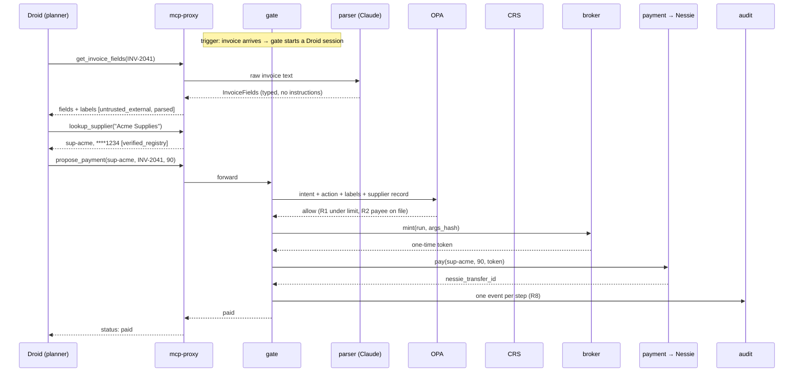

# Sudibran Backend — Sponsor Tracks, Backend Tools and Integrations

Companion to `fastapi_endpoint_plan.md`. It covers:
1. Which sponsor tracks we enter and what each one judges
2. The backend tools (what the agent can call, and what only Sudibran can call)
3. How each sponsor API plugs into those tools
4. What judges must see, and what to check in hour one

> Sources: the **Cal Hacks 13.0 Hacker Guide** (sponsor tracks table) and the Devpost page.
> **⚠ = not in the guide; confirm from the track's Hacker Starter Pack on the Live Site or at
> the booth.** Validate every sponsor endpoint with a script in `scripts/` before building on it.

**Deadlines that shape the build:** Devpost submission **Sunday 9:00 AM** (draft by Saturday
night). Judging is 10:30 AM–12:30 PM at your table, the whole team must be present, the
pitch is about two minutes, and **a live demo is required**. Every project must be started at
the event.

---

## 1. Tracks we enter

| Track | Prize | What they judge (from the guide) | Our entry |
|---|---|---|---|
| **Hyphenate**: The Hyphenated Enterprise, Autonomous Systems for Finance | $8k / $5k / $3k; expedited interviews for the top 5 | Is it real enough? Would you hire it (limited access, clean record, knows when to ask)? Something new? The moment. **They may ask you to run their own scenario.** Bring a video that opens on the moment, one line on the seats it fills, and what's real vs simulated | The whole product. Anchor track |
| **Microsoft**: Grand Prize, Built for the Real World (+ Customer Impact Award) | Surface laptop per member, FDE tech talk, 1:1 mentorship | Customer understanding · measurable usefulness · path from prototype to production · responsible design · end-to-end functionality | Same product, framed as a production agent with metrics |
| **CRS** Financial Intelligence Challenge | $1,000 best overall · $500 best financial AI agent · FDE interviews for best identity/fraud innovation and for most unexpected use | CRS central (not a bolt-on), **runs live against the sandbox**, useful, creative. Agent prize: "an AI agent that does real work with CRS data, using our API or **MCP server**" | R7 payee check + CRS-gated supplier enrollment; Droid uses CRS through our proxy |
| **Factory**: Best Use of the Droid SDK | $2,000 + credits + swag | Droid SDK (TS or Python) does real work in the running product; **README must explain where and how Droid is used**. Scores well: designed trigger, controlled access with safety, visible plans/steps/results. Scores poorly: chatbot wrapper, slide-only demo, can't tell what the agent did | Droid is Maya's AP agent, triggered by invoice arrival, boxed in by Sudibran |
| **Capital One**: Best Use of Nessie | $300 Giftogram per person (Devpost also lists $1,200 cash ⚠) | Completeness, creativity, complexity | The payment rail Sudibran governs |
| **Anthropic** | $5,000 Claude credits + 1 year Claude Max 20x + office hours | Named community · real problem (lived it or talked to someone who has) · it works · thoughtful use of Claude, and you know where it could go wrong for those people | Community: **accounts-payable clerks at small firms**. Claude is the parser; Droid runs on Claude |
| **Armadin**: Best Security Hack | Apple headphones (criteria "coming soon" ⚠) | Not published yet | The security design itself |

**Not entering:** Visa (shopping experience, not B2B payments), Coinbase x402, Fetch.ai,
Spacetime, Convex and the rest. Each would add a bolt-on, and bolt-ons are exactly what CRS
and Factory judges mark down.

**Workshops to attend (Saturday):** Factory "Shipping with the Factory Droid SDK" (B), Hyphenate
"Beyond Agentic Harnesses" (A), Microsoft "System Design for Deployed Agents" (A or D), Visa
"AI and Security in Digital Payments" (D, for pitch material). Visit the CRS booth in hour one (C).

---

## 2. Backend tools

There are two kinds of tool, and keeping them apart is the design.

- **Agent-facing tools** are the *only* things Droid can call. They are served by `mcp-proxy`
  as one MCP server. None of them moves money or returns raw untrusted text.
- **Sudibran-only tools** are called by the gate after policy says yes. They hold sponsor keys.
  Droid has no route to them.

### 2.1 Agent-facing tools (MCP, served by `mcp-proxy` at `/mcp`)

| Tool | Input → output | Backed by | Labels on the result | Checks before it runs | Attacks it's tied to |
|---|---|---|---|---|---|
| `get_invoice_fields` | `{ invoice_id }` → `InvoiceFields` | invoice-reader fetches the raw invoice; **parser** (Claude) turns it into typed fields. Droid never sees the raw text | `untrusted_external`, `parsed` | R3 report status of the sender | A2, A3, A7 |
| `lookup_supplier` | `{ name }` → `{ supplier_id, name, account_masked, crs }` | supplier-db (Postgres, row-level security) | `verified_registry` | — | A8 (no full account numbers) |
| `verify_payee` | `{ supplier_id, account_ref? }` → `{ result, signals }` | **CRS** (API or their MCP server, through the proxy) | `partner` | Tool fingerprint pinned | A9; CRS agent prize |
| `propose_payment` | `{ supplier_id, invoice_id, amount_usd }` → `{ status, reason, approval_id? }` | gate → OPA → (approval) → broker → payment. Droid gets the decision, never a token | `system` | R1, R2, R4, R5, R7 | A1, A3, A5, A9 |
| `remember` / `recall` | `{ key, value }` / `{ key }` → value + source | gate memory table | keeps the *original* source label | Untrusted text never becomes trusted memory | A4 |
| `send_message` | `{ to, body }` → `{ sent }` | stub that logs only (no real email) | `system` | PD: private data can't go to an outside address | A8 |

Notes:
- There is **no** `pay(account_number)` tool. `propose_payment` takes a `supplier_id`, and the
  payee account is looked up inside Sudibran. That makes R2 true by the shape of the API,
  with OPA as a second check.
- Each tool description is fingerprinted at registration. If a description changes (A6), the
  proxy refuses the call and marks the tool `quarantined`.
- Every call writes one `AuditEvent` (R8): `node = proxy`, `edge = [planner, proxy]`, plus the
  decision and labels.

### 2.2 Sudibran-only tools (internal HTTP, never on the MCP server)

| Tool | Endpoint | Wraps | Key it holds | Called by | Needs |
|---|---|---|---|---|---|
| **payment** | `POST /pay` | Nessie transfers | `NESSIE_API_KEY` | gate, after OPA allow | One-time broker token bound to `{supplier_id, amount, run_id}` |
| **crs client** | `POST /check` | CRS sandbox API / MCP | `CRS_API_KEY` | gate (R7, enrollment) and proxy (`verify_payee`) | — |
| **parser** | `POST /parse` | Claude, no tools | `ANTHROPIC_API_KEY_PARSER` | invoice-reader path only | — |
| **policy** | OPA `POST /v1/data/sudibran/decision` | Rego bundle | — | gate | Timeout → deny |
| **broker** | `POST /mint` | Ed25519 one-time tokens | `SUDIBRAN_SIGNING_KEY` | gate | An `allow` audit event to bind to |
| **registration** | `POST /components`, `/verify` | fingerprints (sha256 of name + description + schema) | — | gate at start-up and on every tool list refresh | — |
| **audit** | (library) | Postgres append-only table | — | everything | — |

### 2.3 How a tool call flows (the $90 invoice, happy path)



For the $140 invoice, OPA returns `deny · R2` at the policy step, the broker never mints a
token, and Nessie is never called. Evidence shows `"never_called": true`.

### 2.4 How Droid is wired to the tools

```
droid/
  .factory/settings.json   # MCP server = http://mcp-proxy:8002/mcp only; built-in shell/file tools off
                           # hooks.PreToolUse → hooks/pre_tool_use.py
  hooks/pre_tool_use.py    # reads the call from stdin, POSTs to gate /hooks/pre-tool-use, blocks on deny
```

Three layers, because Droid hooks fail open: (1) the allowlist means Droid can only see our MCP
tools, (2) the hook asks the gate first, (3) the proxy still needs a valid token for anything
that moves money, and fails closed. If the hook crashes, nothing changes.

**Libraries:** `mcp` (official MCP Python SDK; `FastMCP` with streamable HTTP) for the proxy
server and as a client to CRS's MCP server. `httpx` for Nessie, CRS REST and service-to-service
calls.

---

## 3. Sponsor APIs, one by one

### 3.1 Capital One — Nessie (payment rail)

**API ⚠** (from memory; confirm in hour one)
- Base URL `http://api.nessieisreal.com`, key as `?key=<NESSIE_API_KEY>`
- `POST /customers` → customer `_id`
- `POST /customers/{id}/accounts` `{ type: "Checking", nickname, rewards: 0, balance: 5000 }` → account `_id`
- `GET /accounts/{id}` → `balance`
- `POST /accounts/{payer_id}/transfers` `{ medium: "balance", payee_id, amount, description }` → transfer `_id`, `status`
- `GET /transfers/{id}` → status (check whether transfers start `pending` and when balances move)

**Setup** (`scripts/nessie_seed.py` → `data/nessie.json`): accounts for Maya-protected,
Maya-raw (the `agent-raw` side), Acme `****1234`, Northwind, Bayline, and the attacker `****9917`.

**Plugs into:** the `payment` tool only. `suppliers.nessie_account_id` maps each supplier to
its account.

**Endpoints it touches:** `GET /api/state` (balances from Nessie, 2 s cache, `stale` flag on
failure), `GET /api/evidence/{runId}` (`nessie_transfer_id` or `never_called`),
`POST /api/admin/nessie/sync`.

**Fails:** Nessie error → payment `on_hold`, never "paid".

**Judges see:** the $90 transfer appear in Nessie live, and the $140 one never reach it.

### 3.2 CRS — identity, fraud, and their MCP server

**Getting in:** sandbox keys, docs and test identities at `https://calhacks.crscreditapi.com`.
**Use the provided test identities only.** The guide confirms CRS has both an API and an
**MCP server**. Exact endpoints and auth ⚠ from their docs.

**Hour one** (`scripts/crs_probe.py`): run identity + fraud checks on every test identity and
note which come back clean and which flagged. Assign a clean one to Acme's real account and a
flagged one to the attacker's account. If none is flagged, ask the booth, then fall back to an
identity **mismatch** as the failing signal. **Never fake a CRS response.**

**Plugs into three places:**

| Where | When | Effect | Which CRS prize it serves |
|---|---|---|---|
| `crs` client in R7 | A payment to a new or changed account | Flag → blocked; result in evidence | Best overall |
| Supplier enrollment (`POST /api/suppliers`) | Adding a supplier or changing its account | Flag → enrollment refused; clean → waits for Maya to attest | Identity/fraud innovation |
| `verify_payee` MCP tool | Droid checks a payee itself | Droid does real work with CRS data; the proxy pins CRS's tool descriptions (A6 on a real sponsor tool) | Best financial AI agent |

**New endpoints:** `GET /api/suppliers`, `POST /api/suppliers`, `POST /api/suppliers/{id}/attest`.

**Fails:** CRS down → enrollment refused; payments to *new* accounts go on hold; payments to
already-enrolled accounts continue.

### 3.3 Factory — Droid SDK (the agent)

**What we know** (Factory hooks docs): hooks live in `.factory/settings.json`; `PreToolUse`
runs after Droid builds a tool call and before it runs, gets the call as JSON on stdin, and can
block it. Tool-name matchers differ between doc pages. **⚠ Hooks fail open, and whether they
fire from the SDK is unconfirmed.** Go to the Factory workshop.

**Trigger we designed:** an invoice arriving (`POST /api/story/{id}`, `/api/attacks/{id}`, or
the seller agent's `POST /api/a2a/messages`) starts a Droid session in `app/agents/planner.py`
with Maya's intent and the invoice id. Droid never receives raw invoice text.

**Visibility:** every Droid tool call becomes an audit event, and `GET /api/runs/{runId}/plan`
returns Droid's plan and steps for the UI.

**README requirement:** a "Where and how Droid is used" section pointing at `planner.py`,
`droid/.factory/settings.json` and the hook.

**Fallbacks:** if the Python SDK can't be driven, run `droid` as a subprocess. If Droid can't run
on a Claude model, use Factory's default model and keep the parser on Claude.

### 3.4 Anthropic — Claude (parser, and Droid's model)

Two keys, two processes, two trust levels. The parser reads untrusted text and can only return
a fixed schema, so an injected instruction has no field to travel in:

```python
from anthropic import AsyncAnthropic
from pydantic import BaseModel

class InvoiceFields(BaseModel):
    supplier_name: str
    invoice_id: str
    amount_usd: float
    currency: str
    due_date: str
    account_ref: str | None   # lookup key only, never the payee

client = AsyncAnthropic(api_key=settings.anthropic_api_key_parser)

resp = await client.messages.parse(
    model="claude-opus-5-5",
    max_tokens=2000,
    output_config={"effort": "low"},   # simple extraction, keeps latency down
    system=PARSER_SYSTEM,              # frozen text so it caches
    messages=[{"role": "user", "content": invoice_text}],
    output_format=InvoiceFields,
)
fields = resp.parsed_output
```

- Check `resp.stop_reason` first: `refusal` or `max_tokens` → unparsed → **held for review**.
- Keep `PARSER_SYSTEM` byte-for-byte stable so prompt caching works; confirm
  `usage.cache_read_input_tokens > 0` on repeat runs.
- Cache parser results for scripted scenarios (keyed by sha256 of the invoice) so a rate limit
  can't break the live demo.

**For the Anthropic judges:** the README names the community (AP clerks at small firms), cites
the clerk interview, and has a "where Claude could go wrong for them" section: injected
invoices, a fooled planner (the assume-breach switch), refusals. For each one it says what
Sudibran does.

### 3.5 Hyphenate, Microsoft, Armadin (no APIs, judged on the system)

| Track | Backend pieces that answer it |
|---|---|
| Hyphenate "is it real" / "proof it works" | Real Nessie + CRS, `/api/metrics`, `/api/health` (lists what's live vs simulated) |
| Hyphenate "would you hire it" | Tools in §2.1 (limited access), `/api/audit/verify` (clean record), approvals (knows when to ask) |
| Hyphenate "their own scenario" | `/api/inject` on the real parser + OPA `INTENT` rule. Rehearse cold |
| Hyphenate "defends a decision" | `/api/audit?run_id=` with rule + policy digest per event |
| Microsoft customer understanding | The AP clerk interview; threshold and evidence fields set from it |
| Microsoft measurable usefulness | `/api/metrics`: attack block rate, benign completion on 20 invoices, added p95 latency |
| Microsoft path to production / responsible design | Fail-closed matrix, container split, secrets per container, honest limits |
| Armadin | Compose network split (`docker compose exec agent curl …` fails), kill switches, tamper demo, no code path that sets a trust label |

---

## 4. Secrets: where each key lives

| Env var | Only in | Never in |
|---|---|---|
| `NESSIE_API_KEY` | payment | agent, gate, parser |
| `CRS_API_KEY` (+ OAuth client if their sandbox uses it ⚠) | crs client | agent, parser |
| `ANTHROPIC_API_KEY_PARSER` | parser | everything else |
| `ANTHROPIC_API_KEY_PLANNER` / `FACTORY_API_KEY` | agent (Droid) | everything else |
| `SUDIBRAN_SIGNING_KEY` (Ed25519) | gate + broker | agent |

`.env.example` lists names only; `.env` is git-ignored. No keys in the repo (several tracks
require this).

---

## 5. Hour-one checklist

| # | Check | Script | Owner |
|---|---|---|---|
| 1 | One real Nessie transfer; balance moves | `scripts/nessie_seed.py`, `scripts/nessie_transfer.py` | C |
| 2 | CRS: one clean and one flagged test identity; list CRS MCP tools | `scripts/crs_probe.py` | C |
| 3 | Droid from Python on a Claude model; `PreToolUse` fires and can deny; Droid sees an MCP server we serve | `droid/hello_hook/` | B |
| 4 | Parser returns `InvoiceFields` for the $140 invoice and drops the injected account | `scripts/parser_smoke.py` | B |
| 5 | Read each track's Starter Pack on the Live Site (Armadin criteria, Capital One prize amount, track entry limits) | — | D |

If a check fails, use that section's fallback and add it to the "real vs simulated" list.

---

Sources: Cal Hacks 13.0 Hacker Guide (sponsor tracks, schedule, workshops) ·
[Cal Hacks 13.0 Devpost](https://cal-hacks-13-0.devpost.com/) ·
[Factory hooks reference](https://docs.factory.ai/reference/hooks-reference) ·
[Factory hooks guide](https://docs.factory.ai/cli/configuration/hooks-guide) ·
[CRS sandbox overview](https://crscreditapi.com/crs-sandbox-evaluation-credit-data-api/)
